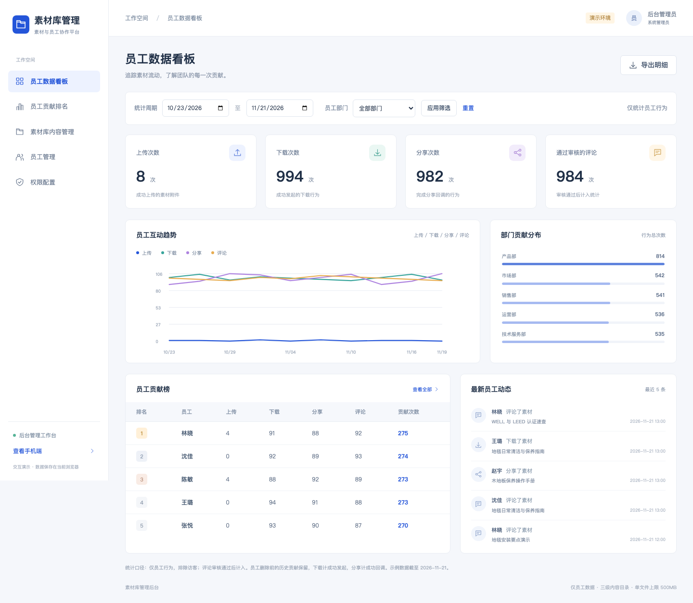

# 素材库管理后台 Demo

**[进入管理后台](https://leo131496.github.io/HTEP/?view=admin)** · **[切换手机端](https://leo131496.github.io/HTEP/?view=mobile)**

同一展示页顶部提供「手机端 / 管理后台」两个 tab，切换时保留各端页面与手机端会话。

## 手机端与后台分工

| 使用端 | 进入方式 | 功能范围 |
| --- | --- | --- |
| 手机端 | 员工手机号 + 验证码登录 | 素材检索、三级文件夹浏览、文件阅读、下载、分享、收藏、评论、我的评论/分享/收藏/下载 |
| 管理后台 | 直接进入管理界面，无需登录 | 员工看板与排名、素材上传与管理、员工导入删除、评论审核、目录与内容权限配置 |

手机号登录属于手机端。后台不展示员工登录、验证码、退出登录或后台角色分配；管理操作统一显示「后台管理员」，与手机端员工身份分开。

## 手机端登录体验

手机端使用演示手机号 `13900000004`，点击「获取验证码」，输入 `123456` 后登录。演示验证码与手机号关联，有效期 5 分钟；登录保留 24 小时，关闭浏览器标签页可结束会话。可使用 `13900000005` 体验另一名员工，个人收藏和互动记录按账号保存。

后台员工页面维护的是手机端账号：姓名、手机号、邮箱、部门与启用状态。邮箱选填，填写时校验格式；手机号与非空邮箱不可重复，邮箱忽略大小写。支持姓名、手机号或邮箱搜索；部门选择即时生效，状态可通过「全部员工 / 已启用 / 已停用」快捷筛选，每页显示 10 位。新增时需主动选择部门，编辑保留原列表位置。CSV 模板为四列：`姓名,手机号,邮箱,部门`；每批最多 500 人、文件不超过 2MB。校验失败时整批不导入。导入前展示文件名、总人数及最多 8 位预览；确认后新员工显示在列表顶部。旧模板需重新下载新版后填写；旧员工账号与历史贡献保留，未维护邮箱的自建员工显示「未填写」。内置演示员工使用 example.com 示例邮箱。

同一浏览器、同一站点下，手机端可读取后台维护的员工名单。新增员工可在手机端登录；已停用或删除的员工无法登录，已打开的手机端会退出该账号。其他浏览器/设备不共享本地员工数据。

## 后台功能

| 模块 | 页面与交互 | 规则 |
| --- | --- | --- |
| 员工数据看板 | 上传、下载、分享、评论四项指标，趋势、部门分布、最近动态、Excel 导出 | 仅员工事件；后台管理员操作不冒充员工行为；评论通过审核后计入；导出按已应用的日期、部门筛选生成五个工作表 |
| 员工排名 | 综合贡献及四类行为排名、日期与部门筛选、CSV 导出 | 综合贡献为四项次数之和，同次数按姓名排序，同名按手机号排序，无行为员工不参与 |
| 素材库内容管理 | 搜索、待审评论筛选、上传、编辑、预览、批量启停、删除 | 每条素材一个附件，支持图片、视频、PDF、Word、Excel；视频仅查看与评论 |
| 员工管理 | 新增、编辑、CSV 模板/校验/预览/导入、邮箱搜索、部门与状态筛选、启停、删除 | 手机号用于手机端登录；停用、删除前展示员工姓名与手机号并确认，历史贡献与互动记录保留 |
| 素材评论（内容行入口） | 点击素材的「评论」，查看该素材的待审核、已通过和已驳回记录；入口显示待审数量 | 仅处理当前素材；驳回原因必填，可取消；记录处理人和时间，通过后贡献只计一次 |
| 权限配置 | 目录权限列表与直接设置、实际可访问人数、单素材操作权限入口、员工权限预览 | 全体员工、指定部门、指定员工；权限继承并取各级范围交集；分别配置下载、分享、评论 |
| 目录管理 | 目录树、新建、改名、移动、权限设置、删除空目录 | 根目录不计入三级；禁止第四级、循环层级、同级重名和删除非空目录 |
| 文件限制 | 选择及提交时双重校验 | 单文件上限 500 × 1024 × 1024 字节；拒绝空文件、不支持格式及与扩展名不匹配的文件头 |

左侧不再设置独立「评论审核」菜单，审核入口统一为「素材库内容管理 → 对应素材 → 评论」。内容列表可筛选「有待审核评论」，入口明确标注「待审」数量；关闭评论弹窗后保留原目录与筛选条件；旧 `#review` 地址跳转至内容管理。

数据看板右上角「导出数据」下载 `.xlsx` 文件，含「看板汇总、每日趋势、部门贡献、员工贡献排名、行为明细」五个工作表。修改筛选条件后会暂停导出，点击「应用筛选」后再导出，避免使用旧条件。文件名和汇总页注明筛选范围；导出包含周期内全部记录，空结果保留表头及零值。

未选择素材时批量操作置灰；部分选择时全选框显示半选。单项与批量禁用均先确认，删除会显示具体素材和附件名称。权限页可直接设置目录范围、查看有效访问人数；没有员工时显示引导入口。

后台上传由「后台管理员」执行，不直接加入员工贡献；示例中员工上传为历史行为数据。看板与排名共用员工事件列表。员工、素材删除或禁用后，既有历史贡献不会被反向删除。

## Demo 边界

这是静态交互原型。手机号验证码不发送真实短信，前端登录校验不能代替生产身份验证。后台按本次要求直接开放演示入口；正式环境可由现有管理平台统一承载身份和授权。

后台元数据存放在 localStorage，附件存放在 IndexedDB。手机端使用独立会话、按员工隔离的个人记录与附件存储。清除浏览器数据会清除本地修改。旧版手机端存储保留，但不会自动归属到任意新员工账号。

两端当前联动范围是同浏览器的员工名单与登录状态；素材上传、目录权限、评论审核和统计仍为独立演示数据，尚未通过统一 API 实现业务联动。正式环境需接入短信、员工与内容数据库、服务端权限、对象存储及事件采集。未实测各设备 500MB 文件的实际存储容量；浏览器配额不足时会提示保存失败。

## 验证与运行

在仓库根目录运行 `python3 -m http.server 4188 --bind 127.0.0.1`，访问 `/`，通过顶部两个 tab 查看；底层独立页面分别为 `/mobile/` 和 `/admin/`。

- `check-workflows.cjs`：待审筛选、审核后列表更新、批量选择与确认、直接目录权限设置、权限继承、空员工引导和窄屏布局。
- `check-export.cjs`：Excel 下载、五个工作表及总数一致性、日期和部门筛选、空结果、文本转义和导出失败恢复。
- `check-model.cjs`：统计、文件大小边界、目录校验、权限交集、员工 CSV 校验。
- `check-ui.cjs`：后台直接进入、看板、内容上传保存、员工管理、审核和布局。
- `check-employee-layout.cjs`：部门必选、编辑位置保持、长邮箱完整显示、桌面及窄屏排版、末页最后一名员工删除后的分页回退。
- `check-mobile-login.cjs`：手机端登录、错误验证码、停用账号、直接详情链接保护、退出与刷新、账号记录隔离、同浏览器员工名单联动及两端独立入口。

浏览器检查需要 Playwright。手机端源码位于工作区 `ThinktankDemo`，发布文件为 `mobile/index.html`；仓库根目录的 `index.html` 为双 tab 展示页。
